# Profiling

This document provides setup instructions to profile the `oscars-backend` service as part of local development, and the CI/CD pipeline.

## Profiling during development

We leverage VisualVM to view real time profiling data of the `oscars-backend` service.
Please obtain [VisualVM](https://visualvm.github.io) for your platform.

The local `oscars-backend` ocd-stack service is started with the appropriate Java arguments to enable remote JMX connections (without security enabled).

We are using [OrbStack](https://orbstack.dev) to run our docker compose services locally.

_**NOTE:** Staging and production environments should always have HTTPS and security authentication configurations enabled._

## Steps to connect VisualVM

1. Right-click "Remote" in the Applications sidebar view, and click "Add Remote Host" 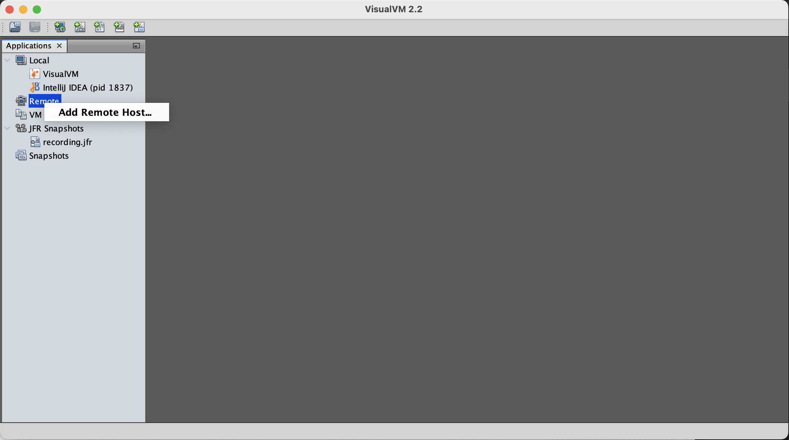
1. In the "Add Remote Host" modal dialog, set the Host name to the `oscars-backend` domain. If using OrbStack, it should be [oscars-backend.ocd-stack.orb.local](oscars-backend.ocd-stack.orb.local). Click "OK" to save and close the modal dialog. 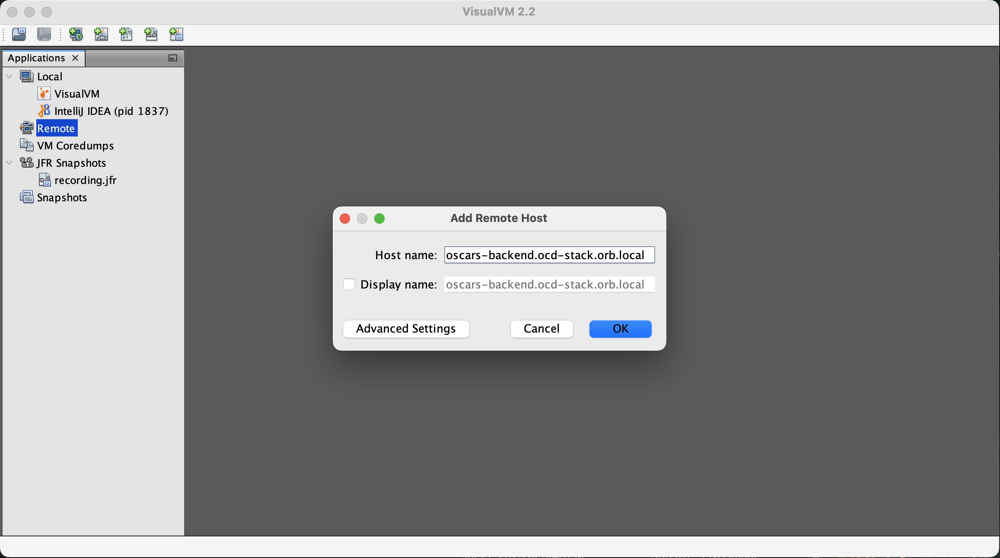
1. There should now be an item in the "Remote" section of the Applications sidebar. Right-click the new entry, and click "Add JMX Connection". 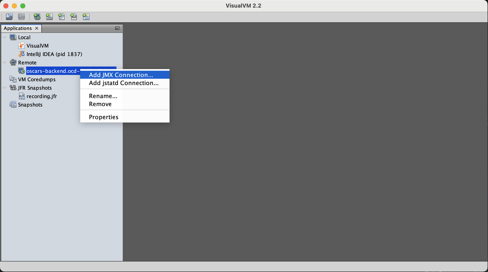
1. In the "Add JMX Connection" modal dialog, the "Connection" string should specify port 1099 (`hostname:port` format). For local development, ensure "Do not require SSL connection" is checked. Keep everything else as-is. Click "OK" to save and close the modal dialog. 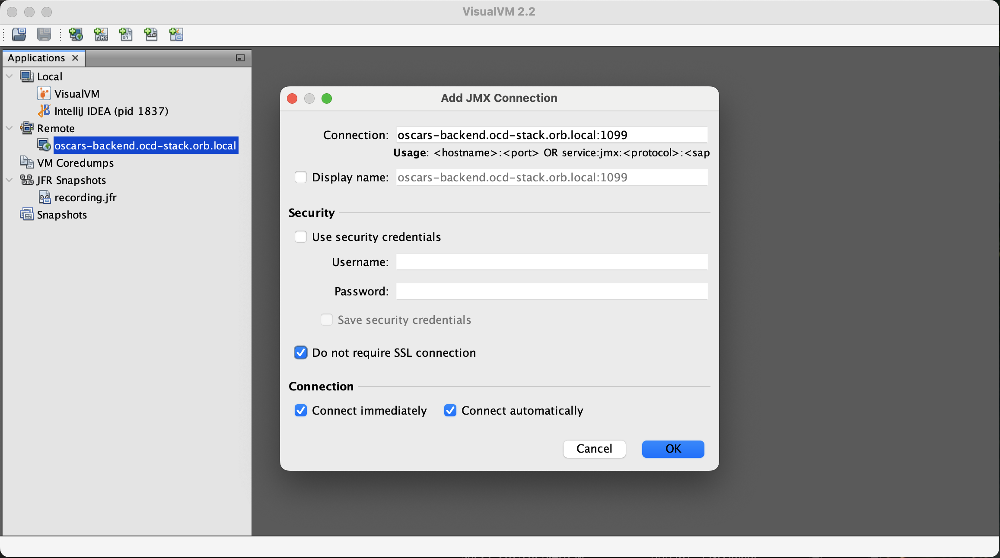
1. There should now be an item under "Remote > oscars-backend.ocd-stack.orb.local" named `org.springframework.boot.loader.launch.JarLauncher (pid 1)`. Right-click it and then click "Open". 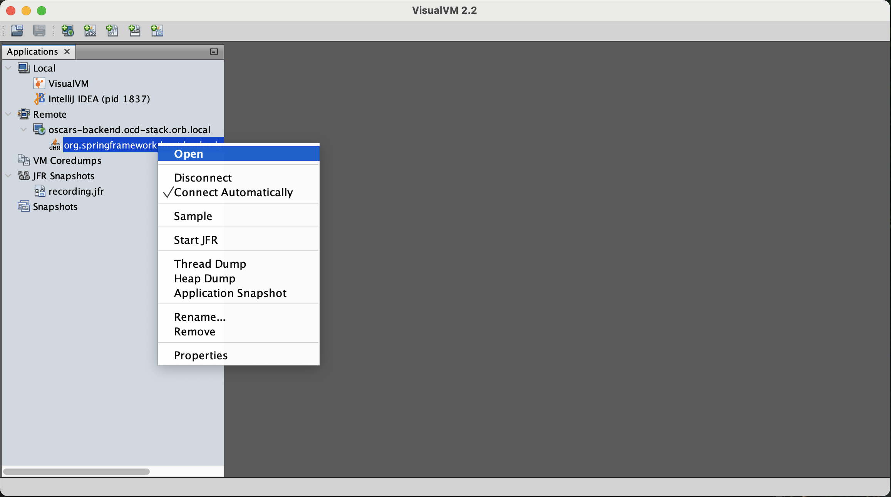
1. A new tab should have opened within VisualVM. This tab allows us to monitor multiple aspects of the `oscars-backend` application stack using the "Monitor" sub-tab. We can also sample CPU and Memory using the Sampler sub-tab.

## Save Java Flight Recorder Data in VisualVM

1. Right click "Remote > oscars-backend.ocd-stack.orb.local > org.springframework.boot.loader.launch.JarLauncher (pid 1)". Click "Start JFR". The VisualVM status bar (lower-right side of the window) will show "Starting JFR Recording". 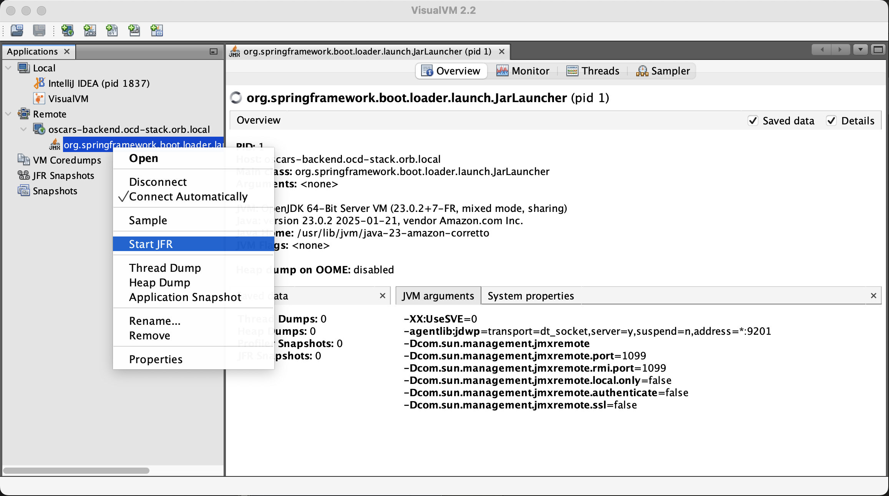
2. Interact with the `oscars-backend` service as usual.
3. Use the "Dump JFR" option at any time during the JFR session. Please take note of _where_ the JFR file is being saved within the `oscars-backend` container! 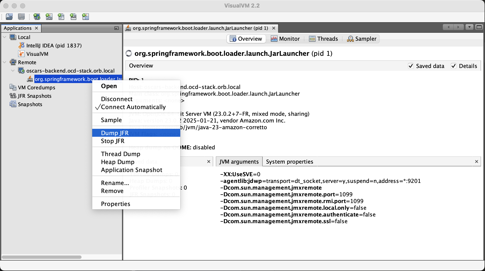 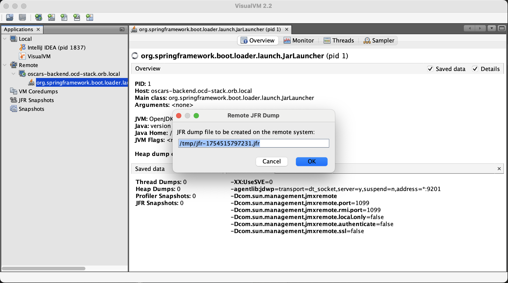 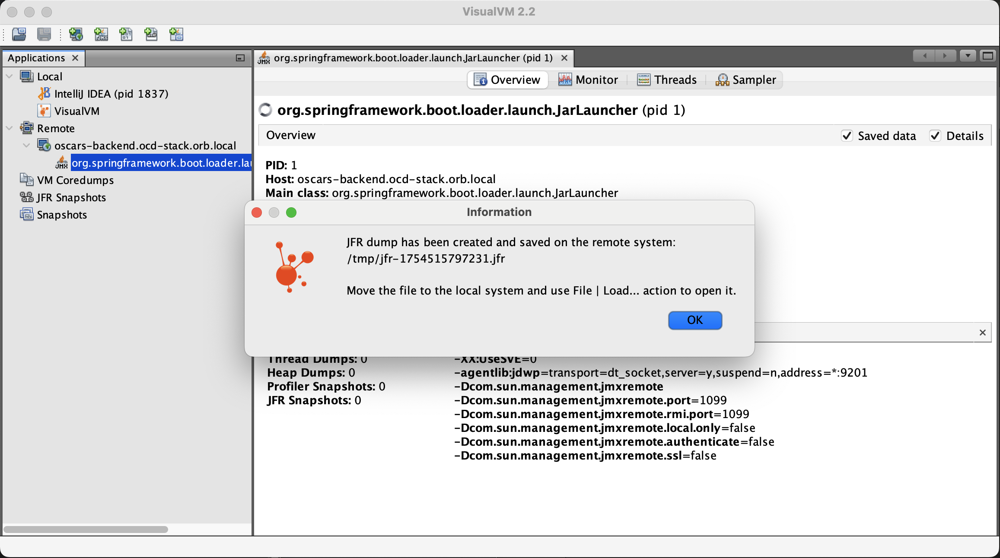
4. When you are done, right click "org.springframework.boot.loader.launch.JarLauncher (pid 1)" and click "Stop JFR". 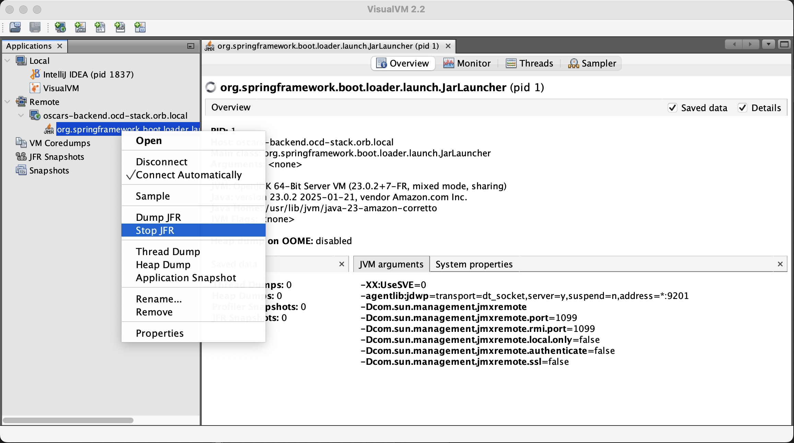
5. Extract the JFR dump file from the `oscars-backend` container if you need it. The `oscars-backend` container is not currently set up to use volumes, so any saved file data will not persist when the service is relaunched! 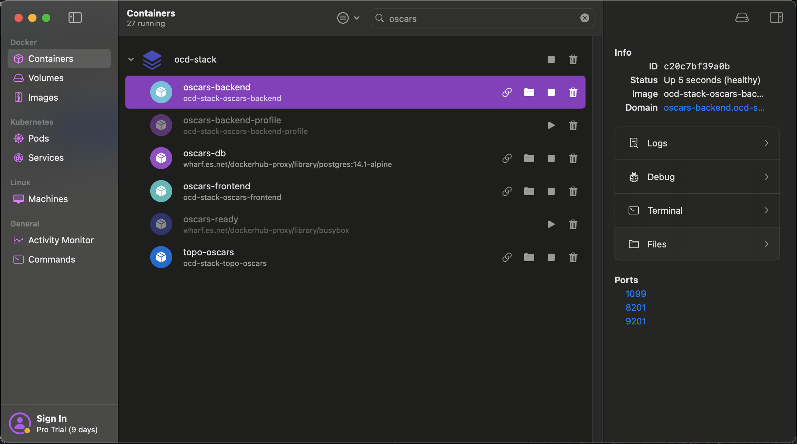 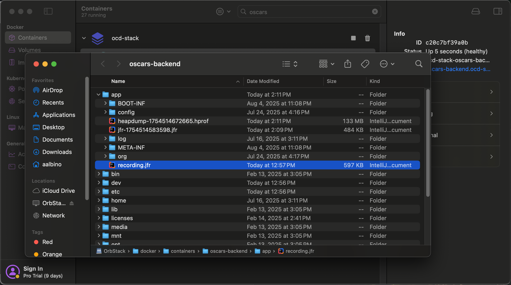

## Profiling within the CI/CD pipeline

1. We have an `ocd-stack` docker compose service named `oscars-backend-profile` that launches a separate container. We can configure the `oscars-backend-profile` service with the following environment variables:
   * `DELAY_MIN`, specifies how long to wait before starting the JFR data recording. See the `sleep` command arguments (examples: 10 seconds as `10s`, 5 minutes as `5m`, etc.)
   * `DURATION_MIN`, specifies how long to run the JFR data recording. See the `sleep` command arguments (examples: 10 seconds as `10s`, 5 minutes as `5m`, etc.) Note: this is informational only — the recording's actual duration is however long the numbered scripts under `backend/src/test/profiling/` take to run (see below), not something `DURATION_MIN` itself controls.
   * `TARGET_HOST`, specifies the `hostname:port` formatted value we establish a JMX connection with.
1. After the recording window ends, the JFR data is dumped to `./backend/profiling/<FILENAME>` on the host (via the `oscars-backend-profile` service's volume mount), ready to open in VisualVM or any other JFR viewer.

### Running load generation during the recording

The `oscars-backend-profile` container runs every `.sh` script under `backend/src/test/resources/profiling/` (copied into the image, in filename order — see that directory's own README) between starting and stopping the JFR recording. `backend/src/test/profiling/500_loadtest.sh` uses this extension point to run the Tier 2 JMeter load test (`backend/src/test/resources/load-testing.jmx`) against `oscars-backend`'s web port for the duration of its own run, so a single `docker compose -f docker-compose.profiling.yml up oscars-backend-profile` produces **both** a JFR recording and a JMeter HTML report for the same load, instead of two disconnected manual tools.

Configure the load with the same shape of properties `make loadtest` uses, passed as env vars to the `oscars-backend-profile` service:

```shell
LOADTEST_THREAD_COUNT=10 LOADTEST_DURATION=120 LOADTEST_RAMP_TIME=10 LOADTEST_THINK_TIME_MS=100 \
  docker compose -f docker-compose.profiling.yml up --build oscars-backend-profile
```

Both outputs land in `./backend/profiling/` on the host: the JFR recording (dumped by `oscars-backend`, which shares that same host directory) and the JMeter `loadtest-results.csv`/`loadtest-report/` (written by `oscars-backend-profile`, mounted at a different container path — `/app/loadtest-output` — so it doesn't shadow the numbered profiling scripts baked into that image at `/app/profiling`).

To inspect which code paths the load actually exercised, open the `.jfr` file in VisualVM/JDK Mission Control, or use the `jfr` CLI tool bundled with the JDK, e.g.:

```shell
jfr print --events jdk.ExecutionSample ./backend/profiling/latest.recording.jfr | grep net.es.oscars
```
